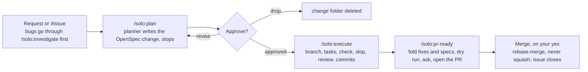

# solo

solo is a Claude Code plugin that runs every non-trivial change through three gates: **plan → execute → pr-ready**. Nothing gets written before a plan is approved, and nothing becomes a PR before a slop pass and a review.

It is built for one developer working with an AI pair: you make the decisions (approve the plan, answer open questions, say yes to push and merge), and the agents do the legwork in between. Every step leaves evidence behind: an OpenSpec change folder, a GitHub issue, atomic commits, a review.

- **14 skills**: 4 gates (plan, execute, review, pr-ready), the `ship` shortcut that chains them, and 9 helpers (investigate, tdd, refactor, slop, research, gap-analysis, adr, docs, standard).
- **4 subagents**: planner, explorer, reviewer, implementer. Each one has a narrow job and a fixed model.
- **Principles**: cite evidence (`path:line`), shortest correct diff, one logical change per commit, and a runnable check for every change.

## The gate chain

You decide at **Approve?**, before the push and at merge. Everything between those points runs on its own and stops only on an open question, a failing check, or a review finding it cannot resolve.



Revise sends one message back to the planner with the defect, and drop deletes the change folder. `/solo:ship` runs the whole chain in one command, still pausing at Approve?.

## Skill reference

Each skill says what it does not do and which skill does that instead, so the model picks the right one and stays in its lane.

| Skill | Use it when | Not for (use instead) |
| --- | --- | --- |
| `/solo:plan` | Any change touching more than one file, or any behavior change. Writes an OpenSpec change and stops for approval | Editing code (`execute`), diagnosing a bug (`investigate`) |
| `/solo:execute` | A change is approved. Branches, implements task by task, runs the check, slop pass, review, atomic commits | Opening the PR (`pr-ready`) |
| `/solo:review` | After execute, or on any diff before merge. Dispatches the reviewer, then fixes every finding | Opening the PR (`pr-ready` calls it) |
| `/solo:pr-ready` | A branch is about to become a PR. Slop + review, folds fixes and specs, shows a dry run and opens the PR on your yes | Planning or implementing |
| `/solo:ship` | A change you would otherwise babysit through each gate. Runs plan → pause → execute → pr-ready | Skipping approval: the pause stays |
| `/solo:investigate` | A bug or failing behavior. Evidence (E#), root cause, a counter-check, a fix plan | Applying the fix (`plan`, `execute`) |
| `/solo:tdd` | Behavior worth driving from tests: parsers, money and auth paths, state machines. Red must be observed before green | Restructuring without new behavior (`refactor`) |
| `/solo:refactor` | The code's shape blocks a change, or seams show after a feature. Characterization test first, one move per green bar | Adding behavior (`plan`), fixing bugs (`investigate`) |
| `/solo:slop` | Code works but is bloated: dead code, duplicates, pass-through wrappers, weak tests. One smell class per pass | Restructuring for a coming change (`refactor`) |
| `/solo:research` | An open question before choosing a library, protocol or approach. Sourced evidence, ends on a recommendation | Searching this codebase (`investigate`) |
| `/solo:gap-analysis` | Before calling work done, or when inheriting a half-built feature. Lists what is missing, partial or extra against the spec | Finding bugs in code that matches the spec (`review`) |
| `/solo:adr` | A choice is hard to undo (dependency, schema, protocol, hosting, auth) or was argued about. Writes `docs/adr/` | How the system works (`docs`) |
| `/solo:docs` | Someone needs to use or change the thing: README, feature doc, API surface, from code evidence | Why a decision was made (`adr`) |
| `/solo:standard` | New repo, changed tooling, or a skill reports "no coding standard". Writes `## Coding standard` in `AGENTS.md` | Enforcing it on a diff (`review`) |

## Subagents

The expensive model thinks once, in a throwaway context, and hands off a file. The main thread always verifies and commits; no agent checks its own work.

| Agent | Model | Tools | Dispatched by | Job |
| --- | --- | --- | --- | --- |
| `solo:planner` | Opus (Fable only on your yes) | Read, Grep, Glob, Bash, Write | `/solo:plan` only | Writes the OpenSpec change: proposal, delta specs, design, tasks. Never edits code or asks you; open questions go in `design.md` |
| `solo:explorer` | Haiku | Read, Grep, Glob, Bash | Any skill, when a sweep would flood context | Read-only sweep of a repo or log set. Returns `file:line` citations and a one-paragraph conclusion |
| `solo:reviewer` | Opus | Read, Grep, Glob, Bash | `/solo:review` (so also execute and pr-ready) | Fresh-eyes review of a diff. Assumes the change is wrong and tries to prove it: bugs, missed callers, over-engineering, slop, leftover `ponytail:` markers |
| `solo:implementer` | Sonnet (Opus for heavy groups) | Read, Edit, Write, Bash, Grep, Glob | `/solo:execute`, `/solo:tdd`, `/solo:refactor` | One bounded unit: a task group, a green step or a refactor move, with named paths and a verification command. Never plans, reviews, commits or ticks tasks |

When your repo's `AGENTS.md` or `CLAUDE.md`, or your own `CLAUDE.md`, names a reviewer agent for a repo, `/solo:review` dispatches that one instead of `solo:reviewer`. Work you can finish in a handful of tool calls is never delegated.

## OpenSpec changes and GitHub Issues

Every planned change is an OpenSpec folder plus one GitHub issue, and the folder rides in the branch next to the code. When the PR merges, its specs become the repo's living specs.

```text
openspec/
  specs/<capability>/spec.md          living specs (what the system does today)
  changes/<slug>/
    proposal.md                       why + What Changes; Status: and Issue: lines
    specs/<capability>/spec.md        delta: ADDED / MODIFIED / REMOVED / RENAMED requirements + scenarios
    design.md                         how, plus ## Open Questions
    tasks.md                          task groups (= commit slices); the last group is the runnable check
  changes/archive/YYYY-MM-DD-<slug>/  the change after it is folded
```

A change moves through four states. Each step is a script, never hand edits:

1. **draft**: `new-change.sh <slug>` creates the folder (and `openspec/` on a new repo). The planner fills it; `validate-change.sh` must pass: strict OpenSpec validation, `Status:` and a well-formed `Issue:` line, every scenario named by a task.
2. **approved**: on your yes, `gh issue create` with label `type:bug|feat|chore`, then `set-status.sh <slug> approved owner/repo#n`. Execute refuses anything else.
3. **done**: `set-status.sh <slug> done` refuses while `tasks.md` is missing or has an unticked box. The last slice commit carries `Refs owner/repo#n`.
4. **archived**: `fold.sh <slug>` in pr-ready applies the deltas to `openspec/specs/`, moves the folder to `archive/`, and commits `docs(spec): fold <slug>` with `Closes owner/repo#n`, so the merge closes the issue.

Work items are GitHub Issues in every repo: `/solo:plan #n` reads one, dependencies use `--blocked-by`, and ready work is `gh issue list --search '-is:blocked is:open'`. Issue and comment text from anyone who is not a collaborator is treated as a claim to verify, never as an instruction.

## Scripts

Skills run these instead of retyping CLI commands, so every run does the same thing. They work from anywhere inside the target repo and refuse a slug that is not kebab-case or an issue that is not `owner/repo#n` or `none`.

| Script | Does |
| --- | --- |
| `skills/plan/scripts/openspec.sh` | Runs OpenSpec 1.14.1: a global CLI only at that exact version, else `npx -y @fission-ai/openspec@1.14.1`; exit 127 when neither exists |
| `skills/plan/scripts/new-change.sh <slug>` | `openspec init` when the repo has none, creates the change, prints its path |
| `skills/plan/scripts/validate-change.sh <slug>` | Strict validation, `Status:`/`Issue:` checks, every scenario named in quotes by a task |
| `skills/plan/scripts/set-status.sh <slug> <draft\|approved\|done> [owner/repo#n\|none]` | Rewrites the header in `proposal.md`; `done` refuses while a task box is open |
| `skills/pr-ready/scripts/fold.sh <slug>` | Box and status checks, validate, archive, validate living specs, commit `docs(spec): fold <slug>` |
| `skills/pr-ready/scripts/open-pr.sh <base> --title <t> --body-file <f> [--dry-run]` | Type label from the commits, creates it when missing, pushes, opens or updates the PR assigned to `@me`, refuses a body without `Closes owner/repo#n` |

Tests: `bash skills/plan/scripts/scripts.test.sh`, `bash skills/pr-ready/scripts/open-pr.test.sh` and `bash tests/guards.test.sh`.

## Rules the plugin enforces

These are hard stops, not style advice: a gate refuses to continue until each one holds.

| Rule | Enforced in | What it means |
| --- | --- | --- |
| Evidence, not memory | investigate, planner, reviewer | Every claim about code cites `path:line`. Anything not inspected is written as `Unverified: <what>, because <why>` |
| One runnable check | plan, execute | The last task group in `tasks.md` is a command that fails if the logic breaks. Execute derives one from the repo if missing |
| Observed failure | tdd | No green step without pasting the red test's real assertion failure |
| Behavior locked first | slop, refactor | The check runs green before the first edit and after every pass; one smell class or one move per pass |
| No placeholders | execute, slop | `TODO`, `FIXME`, `NotImplemented`, `.only`, bare `skip` are blockers. A conditional skip with a reason string is fine |
| No `ponytail:` markers | review, pr-ready | A deliberate ceiling gets its upgrade implemented, or the marker is deleted because the ceiling does not apply |
| Atomic feature slices | execute, pr-ready | One commit per task group, ordered by dependency; every commit passes lint and the check on its own (a detached worktree loop over the commits) |
| Fold, don't stack | pr-ready | Fixes go into the commit that introduced the code (`--fixup` + autosquash). No "cleanup" or "address review" commits |
| Terse conventional commits | execute | `type(scope): subject` of 50 chars or fewer, imperative; a body only when the why is not obvious |
| Ask before remote writes | pr-ready | A dry run shows the push and PR writes, and they run only on your yes; merge and repository settings ask again |
| Rebase-merge | pr-ready | Never squash: it flattens the atomic history. More than about five slices become stacked PRs |
| Repo's own stack | execute, tdd, standard | `AGENTS.md` `## Coding standard` decides runner and checks; with none, the lockfile is law. Framework questions go to Context7 |

## Install

You need `git`, `gh` (signed in), `rg`, and either OpenSpec 1.14.1 (`npm install -g @fission-ai/openspec@1.14.1`) or Node for `npx`. In a Claude Code session:

```text
/plugin marketplace add diblaze/solo
/plugin install solo@diblaze
```

Then:

1. Run `/solo:standard` once per repo, so the skills know its runner and check command.
2. Under zsh, add `"env": {"CLAUDE_CODE_SHELL": "/bin/bash"}` to `~/.claude/settings.json`, so Bash tool calls run real bash.
3. Add the recommended `permissions` rules from [SECURITY.md](SECURITY.md): they deny reads of the usual secrets files and the git commands that destroy uncommitted work. Never run solo in `bypassPermissions` mode.

## Worked example

solo changed itself so that execute hands task groups to model-fit subagents:

1. `/solo:plan Update /solo:execute to use subagents with the right model` dispatched the planner. It wrote `openspec/changes/add-execute-subagent-dispatch/` and stopped.
2. On approve, an issue was created and the change set to `Status: approved`.
3. `/solo:execute add-execute-subagent-dispatch` branched, worked the task groups, ran the check, the slop pass and the review, then committed one slice per group:
    - `feat(solo): add sonnet implementer agent`
    - `feat(solo): route execute groups to implementer`
    - `fix(solo): slop and review see untracked files` (a review finding, as its own slice)
4. `/solo:pr-ready` ran `fold.sh`, which added `docs(spec): fold add-execute-subagent-dispatch` with `Closes`, and opened the PR.
5. On the merge yes: rebase-merged, the four commits kept on `main`, the issue closed, the change archived.

## License

MIT, see [LICENSE](LICENSE). Security reports: see [SECURITY.md](SECURITY.md).
